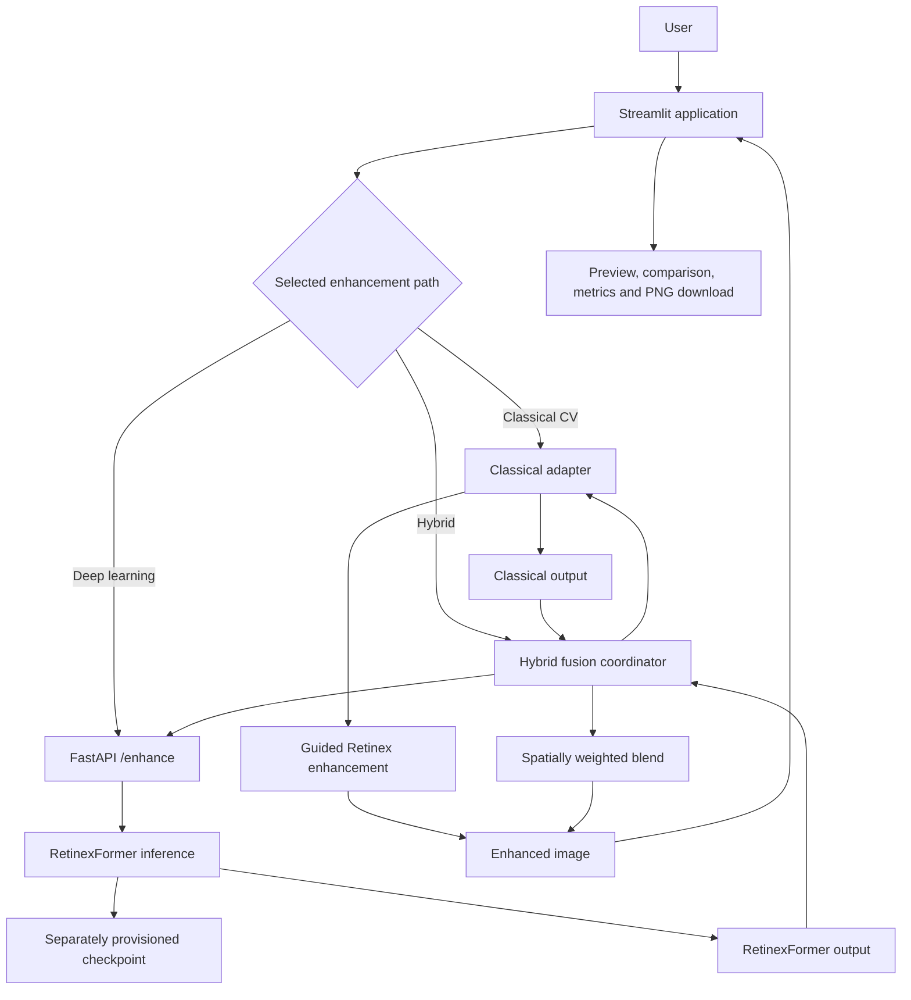

# LUMINA — System Design Document

**Problem ID:** P1  
**Problem:** Robust Low-Light Image Restoration and Enhancement  
**Team ID:** T21  
**Team:** VisionForge  
**Product:** LUMINA  
**Repository:** https://github.com/Vaishnavi-Dhanuka/CV-Hackathon-Project  
**Live frontend:** https://lumina-streamlit.onrender.com

## 1. Purpose and design goals

LUMINA is a low-light image enhancement application. It is designed to improve visibility in underexposed images while limiting noise amplification, colour distortion, overexposure, and loss of edges or textures.

The application exposes three paths so that users can compare different approaches:

1. **Classical CV:** a guided Retinex enhancement path.
2. **Deep learning:** inference using the official pretrained RetinexFormer implementation.
3. **Hybrid:** spatially adaptive heuristic blending of the classical and deep-learning outputs.

The documented evaluation favours standalone pretrained RetinexFormer on the held-out LOL-v1 `eval15` comparison. The hybrid path is therefore retained as an experimental comparison mode, not presented as the production-quality winner.

### Design goals

- Accept an input image and return an enhanced image in a usable format.
- Preserve the input's spatial dimensions and provide RGB output.
- Keep the classical, model-inference, fusion, user-interface, and evaluation responsibilities separated.
- Make the three enhancement approaches comparable through one interface.
- Handle invalid inputs and unavailable inference resources with clear errors.
- Avoid claiming that heuristic fusion weights are learned attention or that the pretrained model was trained by this project.

## 2. System architecture

LUMINA separates the user interface, API/inference service, enhancement implementations, hybrid fusion, and evaluation assets.

### Main modules

| Module | Responsibility |
|---|---|
| Streamlit frontend | Image upload, enhancement-mode selection, result preview, comparisons, visualizations, and download |
| FastAPI service | Exposes health and image-enhancement endpoints |
| `hybrid/classical_client.py` | Prepares the image and calls the guided Retinex classical branch used by the application |
| `deep_learning/retinex_inference.py` | Loads/caches RetinexFormer and performs model inference |
| `third_party/Retinexformer/` | Official RetinexFormer implementation integrated into the repository |
| `hybrid/fusion.py` | Combines classical and deep-learning outputs using fixed/adaptive/spatially adaptive heuristic fusion |
| Evaluation assets | Store experiment outputs, metric summaries, and comparison reports |

## 3. Image-processing paths

### 3.1 Classical CV path

The application-facing classical path uses Retinex-based illumination processing with guided filtering through `hybrid/classical_client.py`. The adapter prepares the input, invokes the guided Retinex enhancement, restores the original dimensions if necessary, and returns an RGB `uint8` result.

The repository also contains a fuller offline classical pipeline. That pipeline should not be confused with the deployed app's **Classical CV** mode: the app-facing mode is the guided Retinex path and does not execute every stage of the separate offline pipeline.

### 3.2 Deep-learning path

The deep-learning path uses the official pretrained RetinexFormer implementation. The FastAPI `/enhance` endpoint accepts an image upload and delegates inference to `deep_learning/retinex_inference.py`.

The inference path:
- uses the configured LOL-v2-real RetinexFormer model configuration;
- loads the separately provisioned pretrained checkpoint;
- caches the model to avoid reloading it for every request;
- supports CPU or CUDA execution where available;
- pads image dimensions as required by the model and restores the original output dimensions; and
- returns an RGB enhanced image.

The configured checkpoint is:

`results/checkpoints/official_only/retinexformer_official_baseline.pth`

The checkpoint is provisioned separately and is not committed as an ordinary repository source file. Deployment therefore depends on the checkpoint being available in the runtime environment.

This project uses a pretrained model. This document does not claim that the team trained RetinexFormer from scratch or specify unverified training losses.

### 3.3 Hybrid path

The hybrid path obtains the classical and RetinexFormer outputs and blends them using spatially adaptive heuristic weights. The weight map varies the contribution of each branch across image regions.

These weights are **blend proportions**, not learned attention maps and not estimates of which output is correct. The hybrid approach is experimental. In the reported 15-image LOL-v1 `eval15` comparison, it did not outperform standalone RetinexFormer on the average quality metrics.

## 4. Application and API design

### Frontend

The Streamlit interface provides:
- image upload and input preview;
- selection of classical, deep-learning, or hybrid enhancement;
- enhanced-image preview and side-by-side comparison;
- available metrics and explainability/intermediate visualizations; and
- PNG output download.

### Backend

The FastAPI service exposes the following routes:

| Endpoint | Purpose |
|---|---|
| `/` | Service/root response |
| `/health` | Health check |
| `/enhance` | Accepts an uploaded image and returns the enhanced result |

The frontend/backend connection is configured through the `LUMINA_DL_API_URL` environment variable. This allows the frontend to target a local API or a separately hosted API without hard-coding the service address in application logic.

### Request flow

1. The user uploads an image in the Streamlit interface.
2. The interface validates the input and the selected processing mode.
3. The selected branch runs locally or calls the FastAPI inference service.
4. The processing module produces an enhanced RGB image.
5. The interface displays the result and any available comparison or metric information.
6. The user may download the result as a PNG.

## 5. Adaptive behaviour and parameter handling

LUMINA provides different enhancement paths and fusion modes rather than treating every image as if it had identical illumination and noise characteristics.

- The guided Retinex path performs the application-facing classical enhancement.
- RetinexFormer performs learned image restoration using pretrained weights.
- Hybrid fusion changes the relative contribution of the two outputs spatially using heuristic weights.

The hybrid weight map is a deterministic blending mechanism. It is not a trained gating network. Do not describe it as learned image-quality assessment or as a validated automatic model selector.

Where the fuller offline classical pipeline is discussed, distinguish it from the application-facing guided Retinex adapter. Do not imply that the app's Classical CV mode executes denoising, CLAHE, colour correction, or adaptive parameter selection unless the relevant code path is changed and verified.

## 6. Input, output, and error handling

### Input

- An uploaded image supported by the application.
- The user-selected enhancement path.

### Output

- An enhanced RGB image, with original spatial dimensions restored by the processing path.
- A PNG download from the interface.
- Comparison or diagnostic visualizations where supported by the selected path.

### Error and operational considerations

- Reject unsupported or unreadable image inputs with a user-facing error.
- Report inference-service unavailability rather than silently presenting an unprocessed image as enhanced.
- Check that the configured checkpoint is present and loadable before inference.
- Keep model loading cached after successful initialization.
- Provision model weights outside Git and document the required checkpoint location.
- Monitor memory and latency: the RetinexFormer model is materially more resource-intensive than the classical path.

**Deployment caveat:** the Streamlit frontend is available at the URL above. Hosted backend inference has had memory/reliability constraints on a free hosting instance; do not assume that the hosted deep-learning endpoint is reliable without a live pre-submission test. Local inference should be tested with the checkpoint provisioned.

## 7. Evaluation design

The project compares at least three approaches, as required by the P1 problem statement:

- classical only;
- deep learning only; and
- hybrid.

The documented comparative evaluation uses the 15-image held-out LOL-v1 `eval15` split. Reported metrics include PSNR and SSIM where paired references are available, LPIPS and NIQE for perceptual/no-reference quality, and latency where recorded. Noise suppression and edge/detail preservation should also be considered in qualitative review.

### Reported comparative results

| Approach | PSNR (dB) ↑ | SSIM ↑ | LPIPS ↓ | NIQE ↓ |
|---|---:|---:|---:|---:|
| Classical Retinex baseline | 16.3686 | 0.5048 | 0.3590 | 7.9804 |
| Pretrained RetinexFormer | 21.7720 | 0.8224 | 0.1524 | 3.8765 |
| Spatial-adaptive hybrid | 18.1390 | 0.5885 | 0.2943 | 7.0345 |

On this comparison, RetinexFormer has the strongest average results across the reported quality metrics. The hybrid result is weaker than RetinexFormer alone and should remain labelled experimental.

Use `eval_P1_T21.md` for the concise comparative-evaluation deliverable. Use the evaluation result files and evaluation report for full methodology, ablations, and failure-case evidence. Do not infer unreported ablation improvements from the table above.

## 8. Limitations and known risks

- The reported comparison is based on a 15-image held-out split; it is not proof of performance on every camera, scene, or illumination condition.
- The hybrid method did not outperform standalone RetinexFormer on the reported mean metrics.
- The pretrained deep-learning path has higher compute and memory requirements than the classical path.
- Hosted backend inference reliability must be checked independently of frontend availability.
- The application-facing classical mode is narrower than the repository's separate full offline classical pipeline.
- The checkpoint must be provisioned in the runtime environment; it is not stored in Git.

## 9. Reproducibility and setup

The project setup guide is the source of truth for exact installation commands and environment configuration. The documented Python version is Python 3.10. Before a demonstration:

1. Install the dependencies using `LUMINA_SETUP_GUIDE.md`.
2. Provision the RetinexFormer checkpoint at the configured path.
3. Set `LUMINA_DL_API_URL` to the intended API endpoint.
4. Start the API and Streamlit frontend using the documented commands.
5. Test each enhancement mode with a sample image.
6. Verify the public URL from both a laptop and a phone, and verify backend inference separately.
7. Keep credentials and secrets out of the repository.

## 10. Related project documentation

- `README.md` — repository overview and entry point.
- `LUMINA_ARCHITECTURE.md` — architecture reference and system diagram.
- `LUMINA_SETUP_GUIDE.md` — local setup and run instructions.
- `LUMINA_DEPLOYMENT.md` — deployment configuration and operational notes.
- `LUMINA_EVALUATION_REPORT.md` — detailed evaluation record.
- `LUMINA_FINAL_REPORT.md` — consolidated project report.
- `eval_P1_T21.md` — comparative evaluation deliverable in the required concise format.

---

**Accuracy note:** This document describes the application-facing paths and reported evaluation at the level supported by the project documentation. Where a detail depends on a specific implementation or deployment revision, verify the current code/configuration before presenting it as a live capability.
